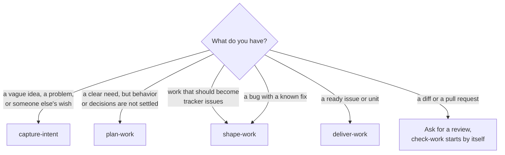

# Where to start

Find the sentence below that sounds most like your situation and use the skill it names. You do not
need to know the rest of the system first. The examples use a direct Claude install, `/<skill>`. In
the Claude plugin the same skill is `/agent-os-core:<skill>` or `/agent-os-dev:<skill>`, and in Codex
it is `$<skill>`.

If you start one step too early, the skill notices that the earlier question is already settled and
moves on. If you start one step too late, it names the step you skipped, and in a project with a
workflow file it stops until that step is done or you say to skip it. Either way you
lose little, so pick the nearest match and go.

## Figure out what to build

**"I have an idea, a complaint from a customer, or a wish, and I am not sure what is really
needed."** Use [`capture-intent`](/skills/capture-intent). It asks one question at a time until the
need is clear. For an initiative, work that several pull requests deliver and whose decisions
someone else must agree to, it writes the need down as an intent file. For anything smaller it
hands you the settled need, ready to become an issue.

**"I know what we need, but not exactly how it should behave, or there are choices nobody has made
yet."** Use [`plan-work`](/skills/plan-work). It reads the code, asks only the questions the code
cannot answer, and settles the behavior, the boundaries, the decisions, and how to prove the result
works. For an initiative it writes this as a spec file; for anything smaller it reports it for the
issues or for delivery.

**"I want to see the screens before anyone builds them."** Use [`design-work`](/skills/design-work).
`plan-work` also offers it when a screen is still undecided.

**"I want this as issues in the tracker," or "this is too big for one pull request."** Use
[`shape-work`](/skills/shape-work). It splits the work into delivery units and creates each one as
a tracker issue: a work order that a person or an agent can start from alone. No intent or spec
file is needed. It asks the product questions that remain; a large open question goes back to
`plan-work`.

## Build it

**"The task is clear. Build it."** Use [`deliver-work`](/skills/deliver-work). By default every
change gets an issue first, so give it the issue, or say "skip the issue". It builds the change,
tests it, has it reviewed by a separate agent, and stops at the boundary you asked for, such as a
local change or a pull request. Give it a tracker issue, a unit from a plan, or the task in your own
words.

**"Finish this whole intent."** Also `deliver-work`, with the intent's id, for example
`/deliver-work finish intent 2026-11-csv-export`. It shapes the plan if there is none and delivers
the units one after another.

**"There is a bug."** Describe it first, and the agent reproduces it and finds its cause before it
changes any code; with agent-os-dev installed that happens without a skill. When the fix is known,
use `shape-work` to give it one issue and then `deliver-work`, so the fix can be traced from the
tracker. When the fix holds a choice, such as what the user should see instead, start with
`plan-work`.

**"Run several ready units at the same time."** Use [`batch-work`](/skills/batch-work). It runs only
when you ask for it by name, because running in parallel is your decision, not the agent's.

## Check and tidy

**"Look at this diff, branch, or pull request."** Ask for a review in your own words.
[`check-work`](/skills/check-work) starts by itself, reports what it finds, and changes nothing.
Say "review and fix" when you want it to fix what it finds.

**"This code feels overbuilt."** Use [`simplify`](/skills/simplify). It can review a diff, look over
a whole repository, or remove code you no longer need.

**"Explain this plan, or make this text shorter."** Use [`explain-work`](/skills/explain-work).

## Set up and find your way

**"This repository has not been set up for Agent OS yet," or "I want to change how we work here."**
Use [`init-agent-os`](/skills/init-agent-os). It asks a few questions about how the team works and
writes the project policy.

**"What do we have planned, and what should I take next?"** Use
[`dispatch-next`](/skills/dispatch-next). It reads the plans and open pull requests and names one
next action with the reason.

**"What can Agent OS do here?"** Use [`list-skills`](/skills/list-skills). It lists what is
installed and how to call it.

## Where you are

Every workflow ends with a line that names the kind of work, the steps that are done, the steps
that are left, and the exact command that continues, such as `/deliver-work #42`. Copy that command
the next day, or hand it to a colleague. The steps for each kind of work are set per project in the
[workflow file](/reference/workflow-file).

## When you do not name a skill

You can always just describe the work. The disciplines run anyway: the agent keeps to the task,
shows evidence before it says something is done, and finds the cause before it fixes a bug. When
your request clearly matches a skill you did not name, the agent says so in one sentence and then
does what you asked. It never starts a manual skill on its own.

Words that are new to you are explained in the [glossary](/guide/glossary).
