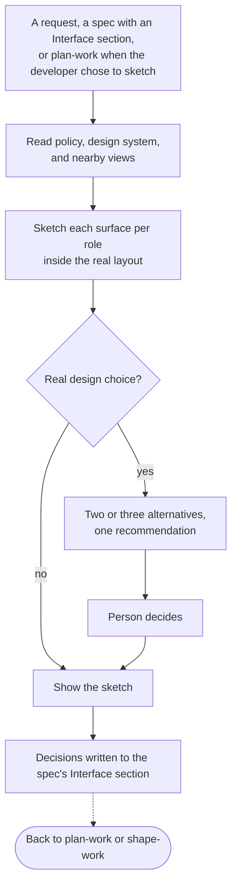

# design-work

**Bucket:** workflow · **Invocation:** manual · `/design-work` (direct Claude), `/agent-os-dev:design-work` (Claude plugin), or `$design-work` (Codex)

Sketches what people will see and do, in the medium the project chose, so a decision can be made by
looking. No design tool is needed, and someone without a checkout can judge the sketches from images.

Sketching is a choice, not a step every change must pass. `plan-work` recommends it when a screen is
still open and asks once whether to sketch now, after the screen is built, or not at all. People
sketch at different points for different reasons:

- **Before a spec exists**, to find out what they are trying to solve. Nothing is written to a spec;
  the skill reports what the sketches settled, and `capture-intent` or `plan-work` starts from that.
- **Before delivery**, to settle a screen, or because they already know exactly how it should look.
- **After delivery**, to reconsider a screen that the spec left to delivery.
- **Not at all.** The spec records the surface as `Left to delivery:` with what delivery may decide,
  and the built screen is judged in the pull request.

A `When` entry in the policy's `## Design` section (`before delivery`, `after delivery`, `ask`, or
`never`) sets the project's default, so the question is not asked each time.



## Set it up the way the project works

The skill is not tied to a tool. The project policy's `## Design` section says how it works, and
`init-agent-os` writes it:

```markdown
## Design

- Sketch with: html
- Sketches live: intents/<id>/sketches/
- Widths: 390, 768, 1440
```

`Sketch with` is `html` for standalone files that need no install, a component workshop such as
Storybook with the command that starts it, `image` for pictures only, or anything else the policy
describes. `Sketches live` is a path, or `not in the repository`. Images are always available when
files cannot be committed: the skill keeps the working files outside the checkout, renders each
sketch to PNG, and puts it on the pull request or at a place you name. With no medium set, the skill asks once and recommends a workshop the repository
already has, and `html` otherwise, then offers to save your answer as `## Design` in the project
policy. It never adds a dependency on its own.

Images come from a bundled script that uses a Chrome or Edge already on the machine:

```bash
node <design-work>/scripts/render-sketch.mjs sketch.html --out images --widths 390,1280
```

It writes one full-page PNG per width and lists console errors, uncaught exceptions, and overflow.
Exit 0 is clean, 1 means it rendered with page errors, and 2 means it could not render. It opens only
local files and local addresses.

## What a sketch holds

Each sketch renders the screen inside the layout the person will actually see, and marks anything
new as new. A workshop uses the project's own components. Any other medium reproduces the look from
the real tokens and layout and says on the sketch that it is an approximation. It shows the states the behavior examples
imply, such as empty, loading, error, success, no permission, and long content, for each role, at
the widths that matter. Data is realistic but made up. When a design question has materially
different answers, the skill builds two or three alternatives side by side, recommends one, and the
person decides.

The skill makes each sketch openable and gives its direct address, then asks one plain-language
question at a time. Wording the spec does not give, such as an error message, is a proposal that the
person confirms. The outcome goes into the spec's `## Interface` section as one bullet per surface,
with `Decided:`, `Deferred to <who> by <when>:`, or `Open:`. The text stands on its own, so the
decision survives a sketch nobody can open later. A sketch's location is a repository path, a pull
request image, or a URL, never a path that exists only on one machine.

A surface that is already decided is sketched again only when its decision is about to change, and
a spec whose Interface section says `None` gets no sketches. Widths come from the policy, or else
from common mobile, tablet, and desktop widths plus the application's own breakpoints. When a named
tool is unavailable, or a workshop's configuration does not pick up the sketch location, the skill
says what is missing and offers `html` for that run instead of changing the configuration.

When the person cannot answer now, the skill commits the spec, with the sketches when they can be
committed, opens a draft pull request that lists each open decision with the address or image of its
sketch, and waits. It never records its own recommendation as their decision.

The exception is a person who explicitly hands the open decisions to the agent for the run, for
example so that work can continue while they are away. The skill then still builds each sketch,
chooses its recommendation, records it as `Decided: (delegated)` with the reason and the rejected
alternatives, and lists every delegated decision in the pull request, where the person can overturn
it. Merging the review is still their acceptance. Being unavailable delegates nothing.

Sketches that can be committed go with the spec. [`deliver-work`](/skills/deliver-work) builds decided
screens to match them and stops at an open or deferred one; a sketch never becomes production code.
After a spec's review has merged, every Interface edit is a reconsideration with a new `rev` and a
decision log line, and plans built on the earlier revision are reshaped. The invocation authorizes
sketch files and the spec's Interface section, not production components, routes, or dependencies.

## Done when

- every sketch opens and renders without errors in its medium, and every image is legible;
- every behavior example with a visible result on a sketched surface appears in a sketch, or the
  spec says why not;
- the sketches were inspected at the widths and states that matter; and
- every surface in `## Interface` has a decision or an explicit deferral with an owner.

## How it fits

[`plan-work`](/skills/plan-work) lists the new and changed screens in the spec and continues into
design-work when they need sketches. [`shape-work`](/skills/shape-work) does not sketch: it links
the settled Interface section and returns an open interface question here, keeping the affected
units blocked until it is settled.
