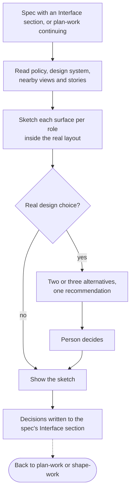

# design-work

**Bucket:** workflow · **Invocation:** manual · `/design-work` (direct Claude), `/agent-os-dev:design-work` (Claude plugin), or `$design-work` (Codex)

Settles what people will see and do before delivery starts. The sketches run in the project's own
component workshop, Storybook by default, so anyone who has checked out the repository and built
its frontend can open and judge them. No separate design tool is needed.

The project policy names the design system, the workshop and the command that starts it, and where
sketches live. When a project has no workshop, the skill stops and says so instead of adding one.

Each sketch renders the screen inside the layout the person will actually see, uses the project's
own components and tokens, and marks anything new as new. It shows the states the behavior examples
imply, such as empty, loading, error, success, no permission, and long content, for each role, at
the widths that matter. Data is realistic but made up. When a design question has materially
different answers, the skill builds two or three alternatives side by side, recommends one, and the
person decides.

The skill starts the workshop for the person and gives the direct address of each sketch, then asks
one plain-language question at a time. The outcome goes into the spec's `## Interface` section: per
surface, the role, the sketch's location, the decision and its reason, and the rejected
alternatives. A deferred decision names who settles it.

A surface that is already decided is sketched again only when its decision is about to change, and
a spec whose Interface section says `None` gets no sketches. Widths come from the policy, or else
from common mobile, tablet, and desktop widths plus the application's own breakpoints. When the
workshop's configuration does not pick up the sketch location, the skill pauses and says so instead
of changing it.

When the person cannot answer now, the skill commits the sketches with the spec, opens a draft pull
request that lists each open decision with the address of its sketch, and waits. It never records
its own recommendation as their decision.

The sketches are committed with the spec. [`deliver-work`](/skills/deliver-work) builds decided
screens to match them and stops at an open or deferred one; a sketch never becomes production code.
After a spec's review has merged, every Interface edit is a reconsideration with a new `rev` and a
decision log line, and plans built on the earlier revision are reshaped. The invocation authorizes
sketch stories and the spec's Interface section, not production components, routes, or
dependencies.

## Done when

- every sketch story renders without render or console errors;
- every behavior example with a visible result on a sketched surface appears in a sketch, or the
  spec says why not;
- the sketches were inspected at the widths and states that matter; and
- every surface in `## Interface` has a decision or an explicit deferral with an owner.

## How it fits

[`plan-work`](/skills/plan-work) lists the new and changed screens in the spec and continues into
design-work when they need sketches. [`shape-work`](/skills/shape-work) does not sketch: it links
the settled Interface section and returns an open interface question here, keeping the affected
units blocked until it is settled.
