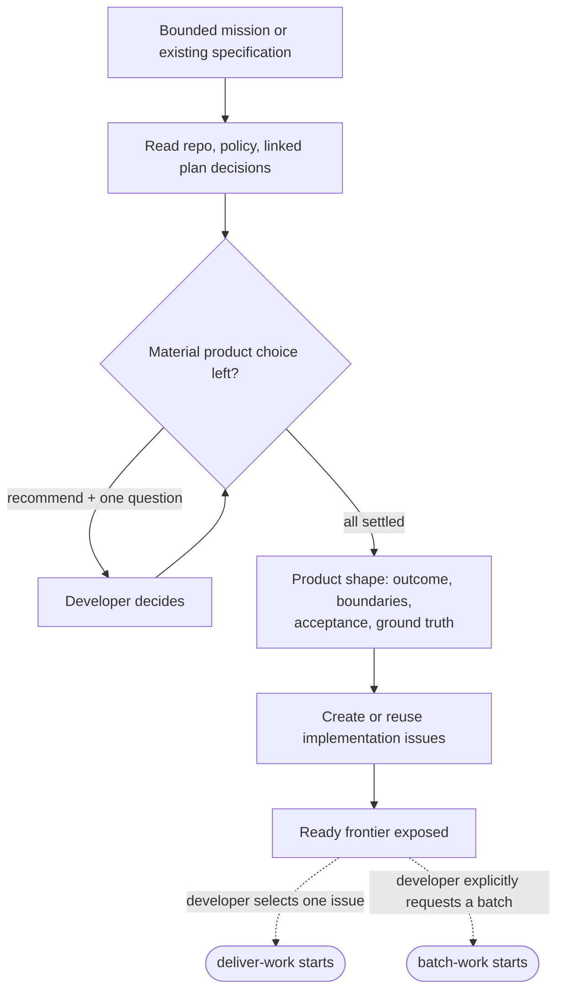

# shape-work

**Bucket:** workflow · **Invocation:** manual · `/shape-work` (direct Claude), `/agent-os-dev:shape-work` (Claude plugin), or `$shape-work` (Codex)

Shapes a bounded mission into coherent delivery units and implementation-ready issues backed by
settled product decisions.



Read the repository, policy, and linked decisions before asking questions. Resolve discoverable
facts yourself. Ask only about product choices that materially change the outcome, always with a
recommendation and its consequence.

Shape-work does not settle the interface; the spec's `## Interface` section does. Units that build
those screens link it. When the section leaves a decision open, is missing for work that changes
what a person sees, or a unit would change a screen it does not cover, shape-work returns that
question to [`design-work`](/skills/design-work) and keeps the affected units blocked until it is
settled. Use a diagram when it makes dependencies or boundaries easier to judge.

Deliver the coherent product shape: outcome, boundaries, acceptance examples, affected seams,
ground truth, settled decisions, and open risks. Start from one coherent delivery unit and split
only for an independent result, ownership, migration, delivery, or material risk and verification
boundary. Separate commits, sessions, files, or technical layers are not enough. Keep schema, API,
UI, configuration, errors, and verification with the behavior they support. Then write the units:
`intents/<id>/plan.md` beside the spec by default, or tracker issues when the project policy makes
the tracker the source of truth for units (`source: issues`, with `plan.md` holding only the keys).
Link real dependencies and report the first claimable frontier to the developer; it is derived from
the plan and is not written into it.

Each unit is a self-contained work order: someone holding only the unit and the repository knows
what to change, where, what done means, and how to prove it. The spec stays the authority. A unit
writes out what it is accountable for and cites its source, and when the two disagree the spec wins.
`built_on` marks restated text stale when the spec changes. Before publishing, shape-work reads each
unit as a worker who has only it and the repository, adds whatever that worker would have to guess,
and removes whatever would not change what they build or check. A unit is a work order, not a design
document: a one-line change gets one-line fields, a typical unit fits in about 4,000 characters, it
carries only the decisions a worker could otherwise get wrong and at most three risks, and it holds
no code or implementation steps.

`plan.md` lists each unit as `- [U1] title`, optionally followed by ` — depends on U1` and
` — blocked: reason`, and gives each unit a `### U1 title` section with its outcome, boundaries,
change surface, written-out acceptance, ground truth, what it consumes from each dependency, settled
decisions, delivery target, and open risks. Unit keys never change. Delivery status is never
written into the plan: a draft pull request with `Intent-Unit: <intent-id>/<unit-key>` claims a unit,
and its merge delivers it. A spec built on an older intent revision is not shaped; it goes back to
plan-work. A plan built on an older spec revision is reshaped with stable keys. See
[Intent, spec, and plan files](/reference/intents).

One shape may produce one issue, several independent issues without an epic, or an epic with
children when one shared result needs an owner. Issue count does not select an execution workflow.
The developer may run any ready issue with `deliver-work`, or explicitly choose `batch-work` for
integrated parallel execution.

When shaping started from `plan-work`, reconcile issue links and readiness into the origin handoff
and map. A shaping handoff alone is not delivery-ready. Shape-work completes only when every selected
branch points to implementation-ready issues or is explicitly parked or rejected.

An epic contract records the shared outcome, acceptance, children or delivery units, aggregate
verification, and the owner of final verification. A child does not authorize siblings or close the
parent; green child checks are not aggregate verification. Deliver-work checks the whole result when
the request covers the epic, and batch-work reuses the same contract.

The invocation authorizes planning artifacts, not product code.

See [Implementation issues](/reference/implementation-issues).

## Transcript: one question, then issues

Condensed illustration of the recommend-then-ask pattern.

```text
User:
/shape-work Turn the report-export branch into ready issues.

Agent:
Settled from the tickets: CSV of the active filtered result, reuse
report-view permission, synchronous through 10,000 rows.

One product choice remains: what happens above the limit?
  a) hide the export action        — invisible, but users ask why it's gone
  b) disable it with an explanation — visible boundary, no silent failure
Recommendation: b. One sentence of UI copy, no new capability.

User:
b.

Agent:
Issues created on the planning surface:
  EXPORT-API  ready    serializer, endpoint, authorization tests
  EXPORT-UI   ready    download action, disabled state above limit
  EXPORT-E2E  blocked  depends on EXPORT-API + EXPORT-UI

Delivery frontier: EXPORT-API, EXPORT-UI. Execution is your choice —
deliver-work per issue, or batch-work if you ask for an integrated batch.
```

## Experiments and continuation

Use the [experiment decision](/reference/prototypes) for technical uncertainty that needs
observation; interface alternatives belong to design-work. Routine choices with sufficient evidence need no prototype. Recommend one
concrete next action with a reason, not only the ready frontier. When the original request also
covers the bounded implementation, continue into sequential delivery; planning alone stops with
the recommendation.
